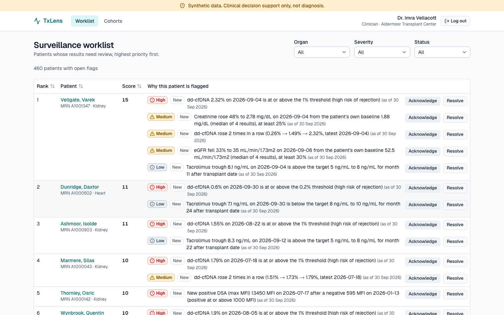
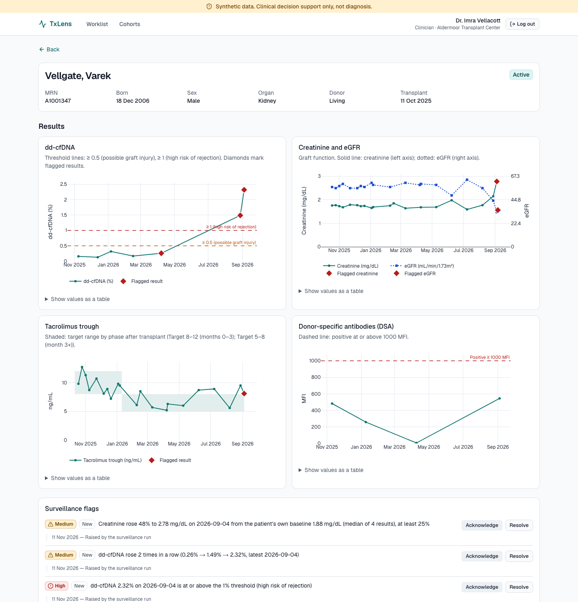
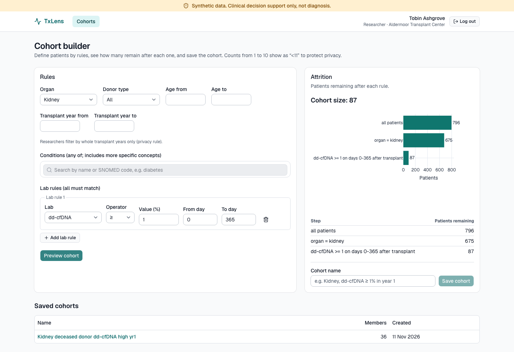
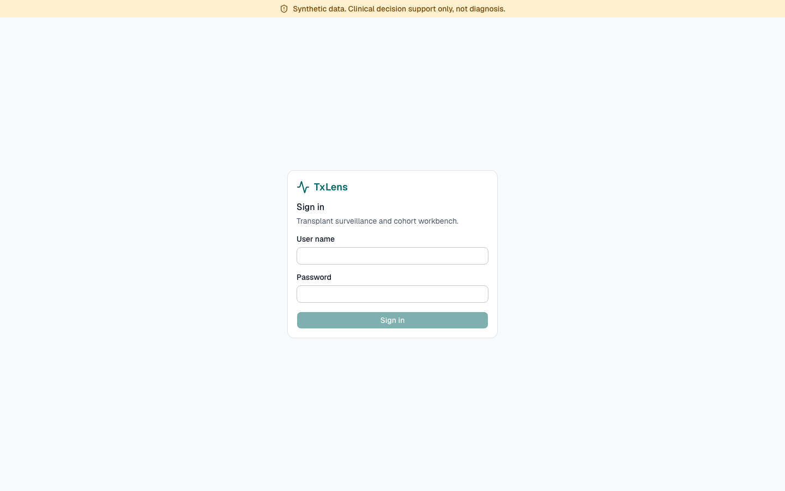
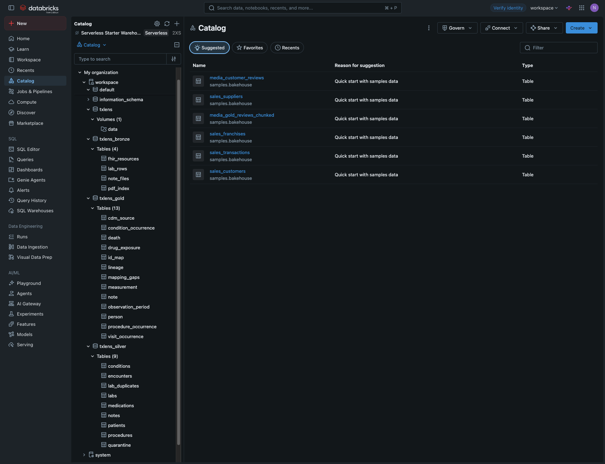
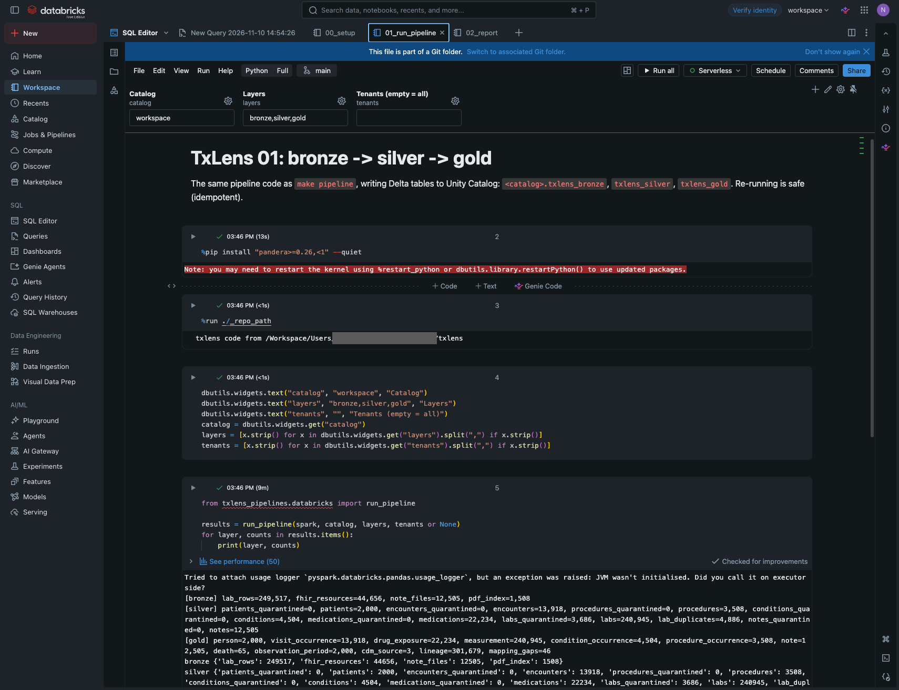
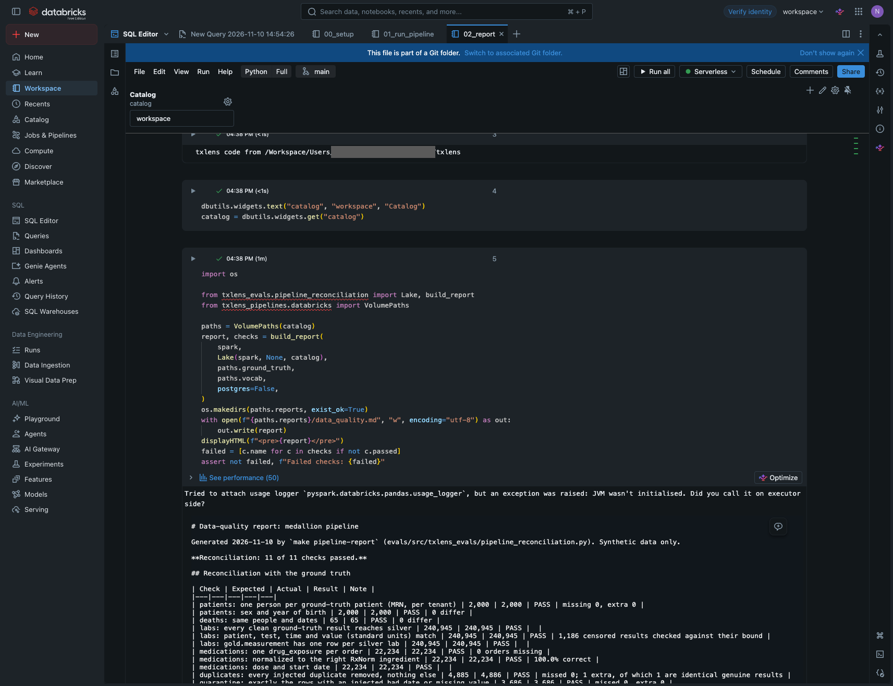

# TxLens

TxLens is a multi-tenant clinical data and AI platform for organ transplant programs
(a personal portfolio project, not affiliated with any company).

- Turns messy transplant data (clinical notes, lab feeds, scanned biopsy PDFs) into
  standardized **OMOP CDM v5.4** data.
- Monitors patients on a post-transplant **dd-cfDNA surveillance** schedule and builds a
  clinician worklist.
- Gives researchers a **cohort and survival-analysis** workbench on de-identified data.
- Offers an **AI copilot**: guarded text-to-SQL over patient data and cited answers over
  transplant literature. The AI extracts and summarizes; it never makes clinical decisions.

> **All data is synthetic**, created by `data_generator/`. No real patient data is used.

**Status:** synthetic data generator, OMOP database, medallion pipeline, backend API and
the surveillance engine with its clinician worklist (Steps 1.1–1.6). Features arrive step by
step.

## Tech stack

| Area | Tools |
|---|---|
| Frontend | Next.js, React, TypeScript, Tailwind, Vitest |
| Backend | Python 3.12, FastAPI, Pydantic v2, SQLAlchemy 2 |
| Database | PostgreSQL 16 + pgvector, OMOP CDM v5.4 (official OHDSI DDL), Alembic, Row-Level Security per tenant |
| Workflows | Temporal |
| Data platform | PySpark + Delta Lake (bronze/silver/gold), runs in Docker and on Databricks |
| AI | LiteLLM, Instructor, LangGraph, Langfuse |

## Repo layout

```
backend/         FastAPI app, models, RLS, auth, Temporal workers
data_generator/  synthetic patients, notes, labs, PDFs + ground truth
pipelines/       PySpark medallion jobs + Databricks job configs
omop/            OMOP DDL, vocabulary subset, mappings
evals/           evaluation scripts and reports
r_parity/        R survival script + Python port + parity tests
frontend/        Next.js app
infra/           docker-compose, Dockerfiles
docs/            architecture, ADRs, LEARNING.md
```

## How to run

You need: [uv](https://docs.astral.sh/uv/), [pnpm](https://pnpm.io/), Node 22 and Docker Desktop.
**No Java needed**: Spark runs inside a Docker container.

```bash
make setup          # install dependencies, create .env from .env.example
# edit .env: put your real OPENAI_API_KEY there (never commit it)

make up             # Postgres + Temporal   (Temporal UI: http://localhost:8233)
make up-full        # ...plus Langfuse      (http://localhost:3001)
make lint           # ruff, mypy, eslint, tsc
make test           # pytest + vitest

make db-migrate     # OMOP schemas (cdm, vocab), tenant RLS, indexes
make db-setup       # ...plus the app login role from APP_DATABASE_URL
make vocab-load     # load the Athena vocabulary zip from omop/athena/ (see omop/README.md)
make vocab-check    # check every code we use against the vocabulary

make generate-data        # 2,000 synthetic patients -> data/raw + data/ground_truth (~240 MB),
                          # plus a 200-patient oncology cohort -> data/oncology
make generate-data-scale  # 20,000 patients, no PDFs/notes -> data_scale/ (Spark volume tests)

make spark-build    # once: build the Spark image (~1 GB)
make vocab-subset   # small vocabulary the pipeline reads (also used on Databricks)
make pipeline       # bronze -> silver -> gold -> Postgres, in the Spark container
make pipeline-report  # reconcile with the ground truth -> evals/reports/data_quality.md
make test-pipelines # run Spark tests inside the container
make databricks-data  # zip for Databricks Free Edition (see docs/DATABRICKS.md)

# edit .env: set JWT_SECRET, DEID_HMAC_KEY (openssl rand -base64 48) and DEMO_*_PASSWORD
make seed-users     # one demo user per role per center, e.g. clinician.center_a
make api            # API at http://localhost:8000 (interactive docs: /docs)
make cohort-report  # cohort rules vs ground truth -> evals/reports/cohort_rules.md
make worker         # Temporal worker for surveillance runs (keep it running)
make surveillance-run  # surveillance for every center as of the data cutoff (2026-09-30);
                       # AS_OF=YYYY-MM-DD replays another date
make surveillance-schedule  # nightly run at 02:00 UTC
make surveillance-report    # replay vs ground truth -> evals/reports/surveillance.md

make frontend       # frontend at http://localhost:3000 (proxies /api to the API on :8000)
make e2e            # Playwright tests on a seeded throwaway database (needs `make up`)
make screenshots    # README screenshots (needs `make api` and `make frontend` running)
make openapi        # after API changes: export the schema, regenerate the typed client
make down           # stop containers (data is kept)
```

Run `make help` to see every command.

The OMOP vocabulary is licensed and never committed: download it yourself from Athena as
described in [omop/README.md](omop/README.md). Tests use a fake TEST ONLY fixture instead.

## Data pipeline results

From [evals/reports/data_quality.md](evals/reports/data_quality.md), produced by
`make pipeline-report` on the default dataset (2,000 patients, 3 centers):

- **Reconciliation with the ground truth: 12 of 12 checks pass.** These include every one of
  240,945 clean lab results matching row by row in standard units, all 65 deaths, and Postgres
  row counts equal to gold for every tenant and table.
- **Medications normalized to the right RxNorm ingredient: 100.0%** (22,234 orders, including
  brand names and abbreviations such as Prograf, tacro, FK506 and MMF).
- **Bad rows quarantined: 3,686**, exactly the rows with an injected bad date or missing value.
  **Duplicates removed: 4,886** (all 4,885 injected, plus 1 explained identical pair).
- **Mapping coverage:** drugs, routes and procedures 100.0%; measurements 96.4% (DSA MFI has no
  standard LOINC); conditions 49.6% (center B sends conditions as uncoded text; note NLP comes
  later).

How it works: [pipelines/README.md](pipelines/README.md) and
[ADR 0006](docs/adr/0006-medallion-pipeline.md). Running it on Databricks:
[docs/DATABRICKS.md](docs/DATABRICKS.md).

## API: roles, tenancy and de-identification

Log in with `POST /auth/login`. The API sets httpOnly, Secure, SameSite=Strict cookies: a
15-minute access token and a rotating 7-day refresh token. Every POST also sends
`X-Requested-With`. Each request runs inside the caller's center through Postgres Row-Level
Security. No endpoint accepts a tenant id, and ids from another center return 404.

| | Patients and timeline | Cohorts | Identifiers (name, MRN, birth date) |
|---|---|---|---|
| clinician | yes | yes | yes; every view audited |
| researcher | de-identified | yes; counts 1-10 shown as "<11", whole-year date filters | never |
| data_steward | de-identified | no | never |
| admin | no | no | never |

De-identified means:
- keyed HMAC pseudonyms (`R-…`) instead of ids
- every date of a patient shifted by the same secret number of days
- 5-year age bands
- no note text or titles

Identifiers are not in OMOP at all; they live in a separate RLS-protected table. A test
scans every researcher and steward response for every identifier and fails on any hit.
Design: [ADR 0007](docs/adr/0007-auth-jwt-cookies.md),
[ADR 0008](docs/adr/0008-phi-separation-deidentification.md).

Cohort results from [evals/reports/cohort_rules.md](evals/reports/cohort_rules.md), produced
by `make cohort-report` on the pipeline-loaded database (2,000 patients):

- **7 of 7 cohort rules match the ground truth exactly**, member by member. For example,
  **198 kidney patients with dd-cfDNA ≥ 1% within 365 days of transplant**, 620 living-donor
  and 1,082 deceased-donor kidney transplants.
- **Known gap:** conditions sent as free text (all of center B, about half of center C) are
  not mapped yet. A "diabetes mellitus and descendants" rule therefore finds 428 of 820
  patients, all of them correct. It is exact for center A, which codes its conditions.

## Surveillance worklist

A config-driven engine flags patients for review. It is clinical decision support and never
diagnoses. Kidney, heart and oncology rules are versioned YAML files: schedule adherence,
marker thresholds, rising trends, creatinine/eGFR change from the patient's own baseline,
tacrolimus range and new DSA. Each flag has a plain-English reason and the values and dates
it is based on. Runs are a Temporal workflow (nightly, or `--as-of` any date). Re-runs are
idempotent, and a resolved flag is never reopened for the same evidence.

| | Worklist and patient flags | Acknowledge / resolve |
|---|---|---|
| clinician | identified | yes; every change audited |
| data_steward | de-identified (all flag dates shifted, notes hidden) | no |
| researcher, admin | no | no |

Results from [evals/reports/surveillance.md](evals/reports/surveillance.md), produced by
`make surveillance-report`. It replays the engine day by day over 2,000 synthetic patients,
using surveillance and routine labs only.

> **These numbers are optimistic.** The synthetic data was generated with the same
> thresholds and signal shapes that the engine checks. They show that the engine, the replay
> and the scoring work end to end. They are not evidence of real-world performance.

- **Kidney: 58% of rejection episodes flagged before the biopsy** (135 of 231), median
  **18 days** earlier. False alarms: 31.9 per 100 patient-years.
- **Heart: 23%** (10 of 43), median 18 days earlier.
- **Injury, not necessarily rejection:** 46% of BK virus, CMV and acute tubular injury
  episodes are flagged too. The marker shows injury, not its cause.
- **Sensitivity vs alert burden:** dropping the dd-cfDNA trend rule cuts kidney false alarms
  from 31.9 to 11.1 per 100 patient-years and halves the daily alert list, but detection
  falls to 52%.
- **Same engine, oncology YAML:** 64% of recurrences flagged before the clinical recurrence
  date, median 40 days earlier, on a synthetic tumor DNA marker cohort.

Design: [ADR 0009](docs/adr/0009-config-driven-surveillance-engine.md),
[ADR 0010](docs/adr/0010-temporal-for-surveillance-runs.md).

## Frontend

A Next.js app with a calm clinical design (shadcn/ui, Tailwind). A banner on every page says
"Synthetic data. Clinical decision support only, not diagnosis." The browser only talks to
the Next.js server: `/api/*` is rewritten to FastAPI, so the httpOnly cookies are
first-party and there are no cross-origin requests. A typed client is generated from the
API's OpenAPI schema. An expired session refreshes itself once, then sends the user to login.

| | Worklist | Patient detail | Cohort builder | Admin |
|---|---|---|---|---|
| clinician | names, acknowledge / resolve | identified, flags + history | yes | no |
| data_steward | pseudonyms, read only | de-identified, flags + history | no | no |
| researcher | no | de-identified, no flags | yes, counts 1-10 as "<11" | no |
| admin | no | no | no | own account only |

| | |
|---|---|
|  |  |
|  |  |

- **Worklist:** ranked by priority score. Filters (organ, severity, status) are kept in the
  URL. Acknowledge or resolve with an optional note: the list updates at once and rolls back
  if the API refuses.
- **Patient detail:** dd-cfDNA with the organ's threshold lines and flagged results marked,
  creatinine and eGFR, tacrolimus with its target band per phase, and DSA. Thresholds come
  from the surveillance YAML through the API. Every chart has a "show values as a table"
  view. A timeline lists transplant, biopsies, graft events and death, plus the medication
  history.
  - Biopsy results show "awaiting document extraction" until Phase 2 reads them from the
    pathology PDFs.
- **Cohort builder:** filter by organ, donor type, age, transplant year, SNOMED conditions
  (including more specific ones) and lab rules. An attrition funnel shows how many patients
  each rule removes. Saved cohorts keep a frozen list of members.
- **Quality checks:** loading, empty and error states show the request id. Vitest covers
  components and the API client. Playwright (`make e2e`) runs against the real API on a
  seeded database and checks:
  - a researcher sees no name or MRN anywhere (page text, URL or console);
  - a steward has no Cohorts menu, and an admin sees no patient data;
  - another center's patient shows "Not found";
  - acknowledge and resolve work;
  - automated WCAG 2.1 AA checks pass (axe), and the review dialog works by keyboard.

Design: [ADR 0011](docs/adr/0011-same-origin-frontend-proxy.md),
[ADR 0012](docs/adr/0012-generated-typed-api-client.md).

## Runs on Databricks

The same pipeline code also runs on Databricks Free Edition (serverless). It writes Unity Catalog
tables and produces **the same row counts as the local run**. The same reconciliation script
reports **11 of 11 checks passed**; the twelfth local check, Postgres vs gold, does not apply
there because Databricks has no Postgres load. Setup guide: [docs/DATABRICKS.md](docs/DATABRICKS.md).

| Bronze, silver and gold tables in Unity Catalog | Pipeline run: row counts per layer |
|---|---|
|  |  |


