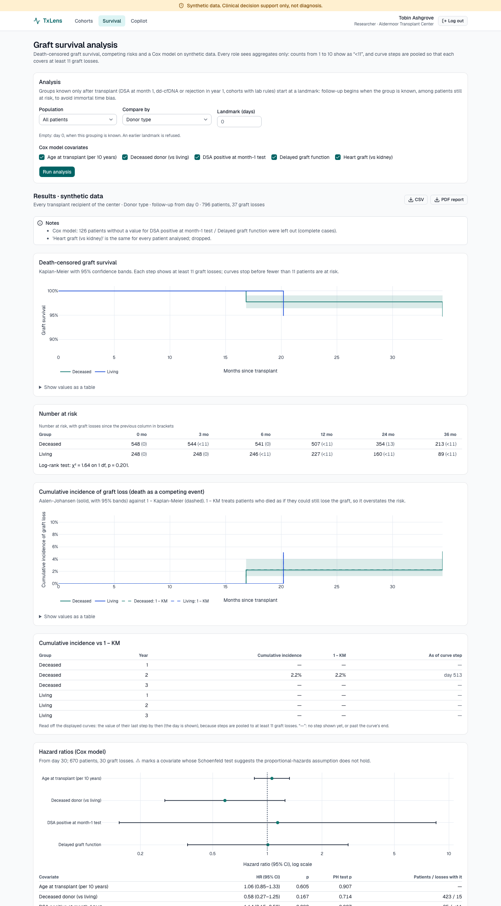
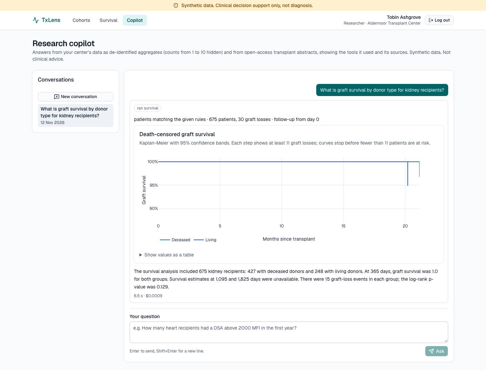
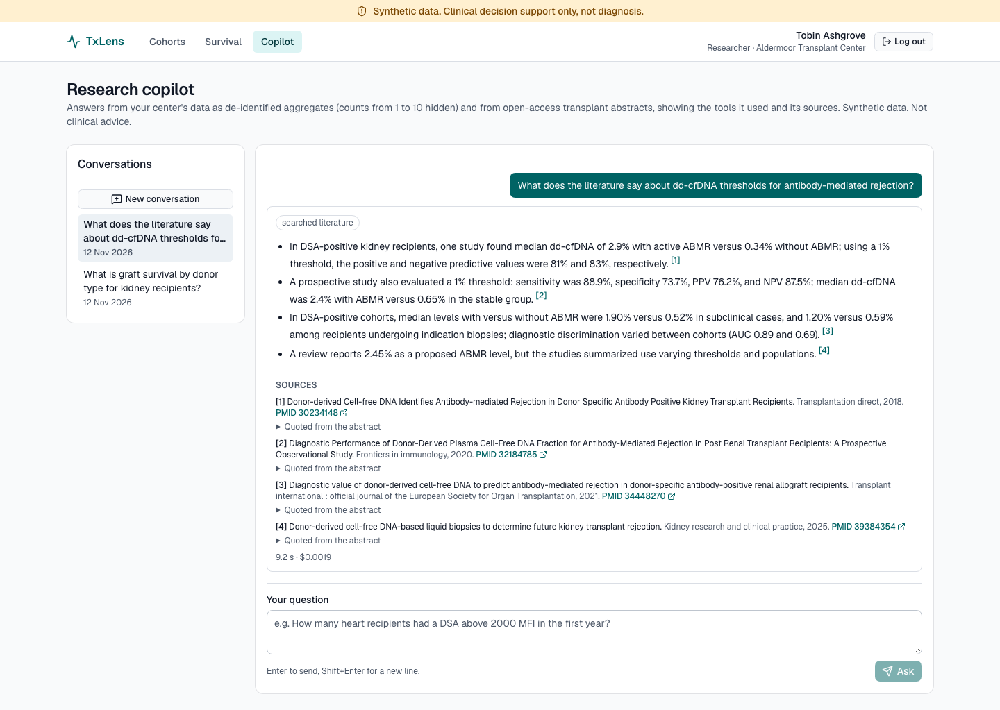

# TxLens

TxLens is a multi-tenant clinical data and AI platform for organ transplant programs
(a personal portfolio project, not affiliated with any company).

- Turns messy transplant data (clinical notes, lab feeds, scanned biopsy PDFs) into
  standardized **OMOP CDM v5.4** data.
- Monitors patients on a post-transplant **dd-cfDNA surveillance** schedule and builds a
  clinician worklist.
- Gives researchers a **cohort and survival-analysis** workbench on de-identified data.
- Offers an **AI copilot**: guarded text-to-SQL over patient data and cited answers over
  transplant literature. The AI extracts and summarizes; it never makes clinical decisions.

> **All data is synthetic**, created by `data_generator/`. No real patient data is used.

**Status:** Phases 1 and 2 are done: synthetic data, OMOP database, medallion pipeline, API,
surveillance worklist, frontend, biopsy-report extraction, clinic-note NLP, the review queue
and their evaluation. Phase 3 has started with survival analysis and its R parity checks
(Step 3.1). Features arrive step by step.

## Tech stack

| Area | Tools |
|---|---|
| Frontend | Next.js, React, TypeScript, Tailwind, Vitest |
| Backend | Python 3.12, FastAPI, Pydantic v2, SQLAlchemy 2 |
| Database | PostgreSQL 16 + pgvector, OMOP CDM v5.4 (official OHDSI DDL), Alembic, Row-Level Security per tenant |
| Workflows | Temporal |
| Data platform | PySpark + Delta Lake (bronze/silver/gold), runs in Docker and on Databricks |
| AI | LiteLLM, Instructor, LangGraph, Langfuse |

## Repo layout

```
backend/         FastAPI app, models, RLS, auth, Temporal workers
data_generator/  synthetic patients, notes, labs, PDFs + ground truth
pipelines/       PySpark medallion jobs + Databricks job configs
omop/            OMOP DDL, vocabulary subset, mappings
evals/           evaluation scripts and reports
r_parity/        R reference script (Docker) + parity tests; the Python port is backend survival/
frontend/        Next.js app
infra/           docker-compose, Dockerfiles
docs/            architecture, ADRs, LEARNING.md
```

## How to run

You need: [uv](https://docs.astral.sh/uv/), [pnpm](https://pnpm.io/), Node 22 and Docker Desktop.
**No Java needed**: Spark runs inside a Docker container.

```bash
make setup          # install dependencies, create .env from .env.example
# edit .env: put your real OPENAI_API_KEY there (never commit it)

make up             # Postgres + Temporal   (Temporal UI: http://localhost:8233)
make up-full        # ...plus Langfuse      (http://localhost:3001)
make lint           # ruff, mypy, eslint, tsc
make test           # pytest + vitest

make db-migrate     # OMOP schemas (cdm, vocab), tenant RLS, indexes
make db-setup       # ...plus the app login role from APP_DATABASE_URL
make vocab-load     # load the Athena vocabulary zip from omop/athena/ (see omop/README.md)
make vocab-check    # check every code we use against the vocabulary

make generate-data        # 2,000 synthetic patients -> data/raw + data/ground_truth (~240 MB),
                          # plus a 200-patient oncology cohort -> data/oncology
make generate-data-scale  # 20,000 patients, no PDFs/notes -> data_scale/ (Spark volume tests)

make spark-build    # once: build the Spark image (~1 GB)
make vocab-subset   # small vocabulary the pipeline reads (also used on Databricks)
make pipeline       # bronze -> silver -> gold -> Postgres, in the Spark container
make pipeline-report  # reconcile with the ground truth -> evals/reports/data_quality.md
make test-pipelines # run Spark tests inside the container
make databricks-data  # zip for Databricks Free Edition (see docs/DATABRICKS.md)

# edit .env: set JWT_SECRET, DEID_HMAC_KEY (openssl rand -base64 48) and DEMO_*_PASSWORD
make seed-users     # one demo user per role per center, e.g. clinician.center_a
make api            # API at http://localhost:8000 (interactive docs: /docs)
make cohort-report  # cohort rules vs ground truth -> evals/reports/cohort_rules.md
make r-build        # once: R reference image (R 4.4.2 + survival + cmprsk) for r_parity/
make r-parity       # Python survival port vs R on the same extracts (pytest -m r)
make survival-report  # parity, immortal time, competing risks -> evals/reports/survival.md
make worker         # Temporal worker for surveillance runs (keep it running)
make surveillance-run  # surveillance for every center as of the data cutoff (2026-09-30);
                       # AS_OF=YYYY-MM-DD replays another date
make surveillance-schedule  # nightly run at 02:00 UTC
make surveillance-report    # replay vs ground truth -> evals/reports/surveillance.md
make ocr-report             # OCR setups on the biopsy PDFs (no LLM) -> evals/reports/ocr.md
make biopsy-report          # 100-report extraction sample vs ground truth (paid LLM calls,
                            # cached; capped by LLM_BUDGET_USD) -> evals/reports/biopsy_extraction.md
uv run txlens-biopsies process data/raw/pathology/center_a  # biopsy PDFs through the workflow

make frontend       # frontend at http://localhost:3000 (proxies /api to the API on :8000)
make e2e            # Playwright tests on a seeded throwaway database (needs `make up`)
make screenshots    # README screenshots (needs `make api` and `make frontend` running)
make openapi        # after API changes: export the schema, regenerate the typed client
make down           # stop containers (data is kept)
```

Run `make help` to see every command.

The OMOP vocabulary is licensed and never committed: download it yourself from Athena as
described in [omop/README.md](omop/README.md). Tests use a fake TEST ONLY fixture instead.

## Headline results

From [evals/reports/summary.md](evals/reports/summary.md): `make evals` reruns every
evaluation on the loaded database (LLM answers come from the cache, so a rerun costs nothing)
and rebuilds the summary. Brackets are 95% bootstrap intervals. **Synthetic,
template-generated data**: these are upper bounds for template-like text, not estimates for
real clinical documents.

| Task | Rules only | LLM only | Hybrid (what TxLens runs) |
|---|---|---|---|
| Biopsy reports (1,508): field F1 | 99.9% (99.9–100.0) | 99.9% (99.9–100.0) | 99.9% (99.9–100.0) |
| Biopsy reports: fully correct | 99.2% (98.7–99.6) | 99.2% (98.7–99.6) | 99.3% (98.8–99.7) |
| Biopsy reports: wrong reports loaded without review | 12 | 12 | **0** (58.3% sent to review) |
| Biopsy reports: LLM cost / report | $0 | $0.00048 | $0.00095 |
| Clinic notes, 300 held-out: mention F1 | 94.3% (94.2–94.4)¹ | 84.0% (83.7–84.2) | 94.3% (94.2–94.4) |
| Clinic notes: temporality / concept accuracy | 69.6% / 100%¹ | 85.2% / 71.5% | 100% / 100% |
| Clinic notes: mentions sent to review / cost per note | 0% / $0 | 100% / $0.0016 | 0% / $0 |
| Clinic notes: latency per note | 10 ms | ~42 s (19 calls of 2.2 s, one after another) | 12 ms |
| Condition texts (2,234 coded rows): mapped to the sent code² | 60.2% (vocabulary only) | – | **100%** (curated + vocabulary) |

¹ Rules only = vocabulary matcher without ConText; medspaCy (rules + ConText) has the same F1
with 100% temporality. ² Code hidden, text mapped, compared with the code; only 19 distinct
texts, so the vocabulary-only interval is wide (0–98%); none mapped wrongly, the rest go to
review. No LLM maps conditions in TxLens.

What this says: on templated text, rules are as accurate as the LLM and far cheaper; the
hybrid earns its cost by routing doubtful biopsy reports to a person (none wrong reached OMOP
unchecked). Reading every note sentence with the LLM was worse and would cost about $20 for
all notes. Method: [ADR 0016](docs/adr/0016-evaluation-method.md).

## Data pipeline results

From [evals/reports/data_quality.md](evals/reports/data_quality.md), produced by
`make pipeline-report` on the default dataset (2,000 patients, 3 centers):

- **Reconciliation with the ground truth: 15 of 15 checks pass.** These include every one of
  240,945 clean lab results matching row by row in standard units, all 65 deaths, and Postgres
  row counts equal to gold for every tenant and table.
- **Medications normalized to the right RxNorm ingredient: 100.0%** (22,234 orders, including
  brand names and abbreviations such as Prograf, tacro, FK506 and MMF).
- **Bad rows quarantined: 3,686**, exactly the rows with an injected bad date or missing value.
  **Duplicates removed: 4,886** (all 4,885 injected, plus 1 explained identical pair).
- **Mapping coverage:** drugs, routes and procedures 100.0%; measurements 96.4% (DSA MFI has no
  standard LOINC).
- **FHIR conditions mapped: 100.0%** (4,504 of 4,504), up from 49.6% with codes only. Free
  text such as "IgA nephropathy" goes through a curated map, exact name or synonym,
  normalized and fuzzy matching, with no LLM. A match is never accepted if type, acuity,
  side, grade, stage or a number differs. The 175 "history of prior kidney/heart transplant"
  rows go to `observation` in the standard OMOP form: *History of event* with the transplant
  procedure as the value. By method: 2,234 by code, 616 curated, 1,654 exact, 0 normalized,
  0 fuzzy.
- **The curated rows are AI-written.** The condition-text and clinic-abbreviation rows of
  `SOURCE_TO_CONCEPT_MAP.csv` were curated by an AI assistant and are **pending clinical
  review**; each row says so.

How it works: [pipelines/README.md](pipelines/README.md) and
[ADR 0006](docs/adr/0006-medallion-pipeline.md). Running it on Databricks:
[docs/DATABRICKS.md](docs/DATABRICKS.md).

## API: roles, tenancy and de-identification

Log in with `POST /auth/login`. The API sets httpOnly, Secure, SameSite=Strict cookies: a
15-minute access token and a rotating 7-day refresh token. Every POST also sends
`X-Requested-With`. Each request runs inside the caller's center through Postgres Row-Level
Security. No endpoint accepts a tenant id, and ids from another center return 404.

| | Patients and timeline | Cohorts | Identifiers (name, MRN, birth date) |
|---|---|---|---|
| clinician | yes | yes | yes; every view audited |
| researcher | de-identified | yes; counts 1-10 shown as "<11", whole-year date filters | never |
| data_steward | de-identified | no | never |
| admin | no | no | never |

De-identified means:
- keyed HMAC pseudonyms (`R-…`) instead of ids
- every date of a patient shifted by the same secret number of days
- 5-year age bands
- no note text or titles

Identifiers are not in OMOP at all; they live in a separate RLS-protected table. A test
scans every researcher and steward response for every identifier and fails on any hit.
Design: [ADR 0007](docs/adr/0007-auth-jwt-cookies.md),
[ADR 0008](docs/adr/0008-phi-separation-deidentification.md).

Cohort results from [evals/reports/cohort_rules.md](evals/reports/cohort_rules.md), produced
by `make cohort-report` on the pipeline-loaded database (2,000 patients):

- **8 of 8 cohort rules match the ground truth exactly**, member by member. For example,
  **198 kidney patients with dd-cfDNA ≥ 1% within 365 days of transplant**, 620 living-donor
  and 1,082 deceased-donor kidney transplants.
- **Diabetes mellitus and descendants: 820 of 820 patients** (was 428 when only coded
  conditions were mapped; center B sends only free text).

## Surveillance worklist

A config-driven engine flags patients for review. It is clinical decision support and never
diagnoses. Kidney, heart and oncology rules are versioned YAML files: schedule adherence,
marker thresholds, rising trends, creatinine/eGFR change from the patient's own baseline,
tacrolimus range and new DSA. Each flag has a plain-English reason and the values and dates
it is based on. Runs are a Temporal workflow (nightly, or `--as-of` any date). Re-runs are
idempotent, and a resolved flag is never reopened for the same evidence.

| | Worklist and patient flags | Acknowledge / resolve |
|---|---|---|
| clinician | identified | yes; every change audited |
| data_steward | de-identified (all flag dates shifted, notes hidden) | no |
| researcher, admin | no | no |

Results from [evals/reports/surveillance.md](evals/reports/surveillance.md), produced by
`make surveillance-report`. It replays the engine day by day over 2,000 synthetic patients,
using surveillance and routine labs only.

> **These numbers are optimistic.** The synthetic data was generated with the same
> thresholds and signal shapes that the engine checks. They show that the engine, the replay
> and the scoring work end to end. They are not evidence of real-world performance.

- **Kidney: 58% of rejection episodes flagged before the biopsy** (135 of 231), median
  **18 days** earlier. False alarms: 31.9 per 100 patient-years.
- **Heart: 23%** (10 of 43), median 18 days earlier.
- **Injury, not necessarily rejection:** 46% of BK virus, CMV and acute tubular injury
  episodes are flagged too. The marker shows injury, not its cause.
- **Sensitivity vs alert burden:** dropping the dd-cfDNA trend rule cuts kidney false alarms
  from 31.9 to 11.1 per 100 patient-years and halves the daily alert list, but detection
  falls to 52%.
- **Same engine, oncology YAML:** 64% of recurrences flagged before the clinical recurrence
  date, median 40 days earlier, on a synthetic tumor DNA marker cohort.

Design: [ADR 0009](docs/adr/0009-config-driven-surveillance-engine.md),
[ADR 0010](docs/adr/0010-temporal-for-surveillance-runs.md).

## Biopsy reports (scanned pathology PDFs)

Each scanned report runs through a Temporal workflow:
1. OCR (Tesseract with preprocessing);
2. link to the patient's biopsy, read from the header locally;
3. two LLM extraction passes (LiteLLM + Instructor, `gpt-6-luna` by default, a local Llama
   optional), with patient identifiers removed first;
4. an evidence check: every value must be quoted from the page;
5. Banff/ISHLT rules;
6. confidence from OCR quality × agreement of the two passes;
7. OMOP: SNOMED conditions and score measurements, with provenance.

Uncertain reports wait for a person (approve / edit / reject), and a random 10% of
confident ones are reviewed as a QC sample. LLM spending has a hard cap per batch, answers
are cached, and every call is traced in Langfuse.

| | Biopsy result on the timeline | Evidence | Review |
|---|---|---|---|
| clinician | yes | full: page image, box, OCR line | yes |
| data_steward | yes | redacted evidence lines only | yes |
| researcher | yes (no document link) | no | no |

Results from [evals/reports/biopsy_extraction_full.md](evals/reports/biopsy_extraction_full.md)
(`--full`) and [evals/reports/ocr.md](evals/reports/ocr.md) (`make ocr-report`), on all
1,508 synthetic reports:

> **Synthetic, template-rendered reports.** One layout and one font; the OCR fixes use that
> template's anchors. These numbers show the workflow works end to end. They are not an
> estimate for real pathology reports.

- **OCR:** 97.1% of key tokens read exactly (65.2% before preprocessing and 200 dpi scans).
- **Extraction:**
  - every kidney Banff score, C4d, grade, diagnosis and finding is at least 99.7% correct;
  - every heart ACR/pAMR grade and diagnosis is 100% correct;
  - dates are 98.5% (kidney) and 99.7% (heart) correct;
  - all 33 fields a report left out came back empty, as they should.
- **Routing (threshold 0.70):**
  - 716 of 716 would-be auto-approved reports fully correct (629 loaded, 87 QC sample);
  - 58% sent to review, mostly for OCR confidence;
  - at 0.85 only 14% would be auto-approved, at 0.50 76%, with 0 errors at any of the three.
- **Prompt injection:** 5 of 5 reports with an injected instruction kept their true values
  (sample run).
- **Cost:** $0.0007 per report; $1.00 for all 1,508 (budget $2.50). 1,498 of 1,508 biopsies
  now show a result on the timeline.

Design: [ADR 0013](docs/adr/0013-biopsy-document-extraction.md).

## Clinic notes (NLP)

12,505 clinic notes are de-identified in the pipeline, then read by NLP:
1. names become surrogates, MRNs `[MRN]`, dates move by the patient's shift; the replaced
   words go to a clinician-only table, and the identified text never enters Postgres;
2. medspaCy: sections, a vocabulary matcher (SNOMED, RxNorm, LOINC and clinic
   abbreviations), ConText for negation, history, hypotheticals and family history;
3. an LLM only for sentences the rules cannot finish (one de-identified sentence, quotes
   checked, the concept chosen by our vocabulary, always sent to review);
4. OMOP: every mention in `note_nlp`; one `condition_occurrence` per note and concept, only
   for affirmed, current conditions of the patient (type concept 32858, NLP).

| | "from note" conditions on the timeline | Evidence sentence |
|---|---|---|
| clinician | yes | as written |
| data_steward | yes | de-identified |
| researcher | yes | none |

Results from [evals/reports/notes_nlp.md](evals/reports/notes_nlp.md)
(`make notes-report ARGS="--full --llm --max-cost 3"`), scored against the generator's
203,489 facts. **Headline: the 12,205 held-out notes**; the 300 notes read while writing the
rules are reported separately (F1 94.3%).

> **Synthetic, template-generated notes** with 38 concepts, and rules written knowing the
> generator. These numbers show the pipeline works; real notes would score much lower.

| Held-out notes | Rules only | medspaCy | Hybrid (+LLM) |
|---|---|---|---|
| Recall | 100.0% | 100.0% | 100.0% |
| Precision (strict) | 89.1% | 89.1% | 89.1% |
| Precision (text the ground truth tracks) | 99.6% | 99.6% | 99.6% |
| F1 | 94.2% | 94.2% | 94.2% |
| Negation / temporality / experiencer | 77.8% / 69.8% / 94.4% | 100% / 100% / 100% | 100% / 100% / 100% |
| Concept | 100% | 100% | 100% |

- Strict precision counts real mentions the generator does not list as facts (the primary
  disease, a dd-cfDNA threshold sentence, biopsy indications) as false positives.
- **LLM cost:** in Step 2.2 the LLM got 3,579 sentences, all with "graft tenderness" (15 paid
  calls, $0.0016; $0.31 without any cache), which lifted recall from 98.2% to 100%. Since that
  term has a curated concept (Step 2.3), the rules find it and the LLM gets 0 sentences: it
  remains only for phrasing no rule knows. De-identification leak check: 0 identifiers in all
  12,505 notes.
- **Temporality fix (Step 2.3):** past rejections in the HPI ("Bx 3/22/24 showed ABMR,
  treated.") were read as current, and "Will arrange for-cause biopsy" as done. Two rules
  found on the tuning notes only (", treated" closes a past episode; "will arrange" is a
  plan) took held-out temporality from 99.8% to 100.0% (382 errors to 0). A rejection still
  called current next to an earlier date or a treatment word now goes to review.
- **Loaded:** `txlens-notes process` (Temporal) wrote 228,428 `note_nlp` rows (0 to
  review) and 26,022 NLP conditions for 1,999 patients, with no new LLM spend (cache). All 8
  cohort rules still match the ground truth (diabetes 820 of 820): family-history diabetes
  adds no patients. [evals/reports/rejection_records.md](evals/reports/rejection_records.md)
  (`make rejection-report`): all 213 rejection conditions read from notes sit just after a
  true rejection biopsy; the late-rejection cohorts (more than 180 / 365 days after
  transplant) have 0 extra patients, and their 31 / 6 missing patients all have a
  borderline-rejection report waiting in the review queue.

Design: [ADR 0014](docs/adr/0014-clinical-note-nlp.md).

## Review queue

One queue for everything a person must check, for clinicians and data stewards of a center:
biopsy reports in review (including the 10% QC sample), note mentions in review, condition
texts the pipeline could not map, and the 83 AI-curated mapping rows. Rejection-related and
high-severity items come first, then the QC sample, then the rest.

| | Queue | Biopsy evidence | Note evidence | Decide | AI-curated rows |
|---|---|---|---|---|---|
| clinician | yes | page image, a box per field | sentence as written | yes | approve / correct / revert |
| data_steward | yes | redacted lines, cropped line images (never the header) | de-identified sentence | yes | read only |
| researcher | no | no | no | no | no |
| admin | metrics only | no | no | no | no |

- Edit, reject and revert need a reason code. Biopsy decisions go to the document's Temporal
  workflow. Every decision, page view and crop view is in `audit_log`.
- AI-curated rows have one shared history for all centers (who, which center, when, why).
  `make vocab-export-curation` writes "clinician-reviewed" labels and corrections back to
  SOURCE_TO_CONCEPT_MAP.csv for the next pipeline run.
- Feedback loop: every reviewed field is a labelled example (model value vs reviewer value).
  [evals/reports/review_agreement.md](evals/reports/review_agreement.md)
  (`make review-report`) reports agreement per field, the QC sample apart, and re-runs the
  note rules on reviewed mentions. **No one has reviewed items in the dev database yet, so
  there are no agreement numbers yet.**
- Waiting now (same report, all centers): 898 biopsy reports, 0 note mentions and 0
  condition texts; the 83 AI-curated rows are shared, so every center sees the same 83.
- "Graft tenderness" filled 3,579 of the 4,477 center items (80%): the LLM found it, but no
  concept existed. SNOMED has only "Tenderness of kidney" (any kidney, Observation domain),
  so kidney notes now map it to a TxLens local concept (GRAFT_TENDERNESS), labelled "curated
  by AI assistant, pending clinical review" and itself waiting in the queue.

Design: [ADR 0015](docs/adr/0015-unified-review-queue.md).

## Survival analysis

From [evals/reports/survival.md](evals/reports/survival.md), produced by
`make survival-report` (synthetic data):

- **What it does:** death-censored Kaplan-Meier graft survival with 95% bands, a risk table
  and the log-rank test. It also shows the cumulative incidence of graft loss with death as
  a competing event (Aalen-Johansen) next to 1 − KM, and a Cox model (forest plot,
  Schoenfeld check). A methods paragraph is written from the analysis. CSV and PDF exports
  are available. For clinicians and researchers, on any population or saved cohort.
- **R parity:** an R reference (`r_parity/`: survival 3.7.0 and cmprsk in a pinned Docker
  image) and the Python port read the same extract.
  - Kaplan-Meier, log-rank and cumulative incidence agree to about 1e-15.
  - Cox coefficients agree to 4e-6.
  - A separate CI job (`r-parity`) fails on any difference beyond tolerance.
  - Where the libraries differ (ties, CI types, jitter, variance) and how the port matches
    R is listed in [r_parity/README.md](r_parity/README.md).
- **Immortal time bias, prevented by the API.** Every grouping knows the day it becomes
  known, and the analysis starts at that landmark. The API refuses an earlier landmark.
  - Simulated data where "dd-cfDNA ≥ 1% in year 1" has no effect (50 datasets): the naive
    comparison gives **HR 0.56** and excludes 1 every time. The landmark design gives 0.99
    and the time-varying design 1.01.
- **Real effect in the data:** from a 1-year landmark, ABMR in year 1 vs no rejection gives
  **HR 17.7 (9.3–33.4)**, and 2-year graft survival is 68% vs 97%.
- **Competing risks:** 1 − KM overstates 3-year graft loss by 0.10 points here (6.11% vs
  6.01%). Deaths are few and late; the gap grows with the death rate.
- **Honest nulls:** the generator gives age, donor type, organ and DGF no effect, and the
  Cox model finds HRs near 1. Known HRs are recovered on a simulated extract.
- **DGF from clinic notes** reaches OMOP as a "History of event" observation; 304 of 304
  are found, with no false positives.
- **Privacy:** small-cell suppression applies to every role and to exports. Counts of 1–10
  show as "<11", and curve steps are pooled to at least 11 graft losses.



Design: [ADR 0017](docs/adr/0017-survival-analysis-and-r-parity.md).

## Research copilot

From [evals/reports/copilot.md](evals/reports/copilot.md), produced by `make copilot-report`
(synthetic data; the literature is real open-access PubMed abstracts):

- **What it does:** clinicians and researchers ask questions in plain English (`/copilot`).
  A LangGraph agent picks one schema-validated action at a time:
  - a concept search;
  - a cohort count;
  - a survival analysis;
  - a guarded aggregate SQL query;
  - a literature search over 2,063 abstracts (pgvector + full-text, Reciprocal Rank
    Fusion).

  Answers stream with the tool trace, "Show SQL", inline charts and PubMed links.
- **Data questions (40, center A):** the expected value appears in the answer in **100%**.
  The right tool ran in 87.5% (77.5–95.0). A structured tool was used where one fits in
  79.2%.
- **Literature (20 questions × 3 runs without the cache):**
  - Every claim carries quotes found verbatim in the abstract it cites. The check is
    string matching in code; claims without a verified quote are dropped.
  - Citations fully supported by the cited abstract: **80.7%** (75.0–86.5); supported or
    partly: 99.5%. Range over the three runs: 76.3–88.5%.
  - RAGAS faithfulness 0.91, answer relevancy 0.67 (0.58–0.74 over runs).
  - Judge: a different model (`gpt-5.6-luna`), so the scores are indicative.
  - 57 of 60 answers came from the literature; 3 read the question as a data question.
  - Before quote grounding, fully supported citations were 88% and then 52% on two sample
    runs.
  - These numbers predate one later fix: years in a claim may also come from the cited
    abstract's title. That fix rescued a Banff-history question whose claims had all been
    dropped. Its effect on the full set is not yet measured.
- **Unanswerable questions:** declined 9 of 9.
- **Red team: 25 of 25 attacks refused or neutralized.** They cover identifiers, other
  centers, writes, SQL-guard bypass, prompt injection in abstracts and in conversation
  history, small-cell probing (including subtracting counts across two conversations and
  through the cohort builder API), and advice about a specific patient.
- **Safety by construction:**
  - SQL runs read-only, as a role that can only read de-identified views, under the
    center's RLS.
  - A sqlglot allow-list accepts only aggregate queries, with `count(DISTINCT person_id)`
    required.
  - Counts of 1–10 are hidden.
  - A per-user differencing guard (30 days, stored in the database) withholds a count
    that, with an earlier one over nested filters, would reveal fewer than 11 patients.
  - Every question and tool call is audited.
- **Cost:** about $0.0019 per question; median latency 8.6 s.




Design: [ADR 0018](docs/adr/0018-research-copilot-safety.md).

## Frontend

A Next.js app with a calm clinical design (shadcn/ui, Tailwind). A banner on every page says
"Synthetic data. Clinical decision support only, not diagnosis." The browser only talks to
the Next.js server: `/api/*` is rewritten to FastAPI, so the httpOnly cookies are
first-party and there are no cross-origin requests. A typed client is generated from the
API's OpenAPI schema. An expired session refreshes itself once, then sends the user to login.

| | Worklist | Patient detail | Cohort builder | Survival | Admin |
|---|---|---|---|---|---|
| clinician | names, acknowledge / resolve | identified, flags + history | yes | yes, suppressed | no |
| data_steward | pseudonyms, read only | de-identified, flags + history | no | no | no |
| researcher | no | de-identified, no flags | yes, counts 1-10 as "<11" | yes, suppressed | no |
| admin | no | no | no | no | own account only |

| | |
|---|---|
|  |  |
|  |  |

- **Worklist:** ranked by priority score. Filters (organ, severity, status) are kept in the
  URL. Acknowledge or resolve with an optional note: the list updates at once and rolls back
  if the API refuses.
- **Patient detail:** dd-cfDNA with the organ's threshold lines and flagged results marked,
  creatinine and eGFR, tacrolimus with its target band per phase, and DSA. Thresholds come
  from the surveillance YAML through the API. Every chart has a "show values as a table"
  view. A timeline lists transplant, biopsies, graft events and death, plus the medication
  history.
  - Biopsy results show "awaiting document extraction" until Phase 2 reads them from the
    pathology PDFs.
- **Cohort builder:** filter by organ, donor type, age, transplant year, SNOMED conditions
  (including more specific ones) and lab rules. An attrition funnel shows how many patients
  each rule removes. Saved cohorts keep a frozen list of members.
- **Quality checks:** loading, empty and error states show the request id. Vitest covers
  components and the API client. Playwright (`make e2e`) runs against the real API on a
  seeded database and checks:
  - a researcher sees no name or MRN anywhere (page text, URL or console);
  - a steward has no Cohorts menu, and an admin sees no patient data;
  - another center's patient shows "Not found";
  - acknowledge and resolve work;
  - automated WCAG 2.1 AA checks pass (axe), and the review dialog works by keyboard.

Design: [ADR 0011](docs/adr/0011-same-origin-frontend-proxy.md),
[ADR 0012](docs/adr/0012-generated-typed-api-client.md).

## Runs on Databricks

The same pipeline code also runs on Databricks Free Edition (serverless). It writes Unity Catalog
tables and produces **the same row counts as the local run**. The same reconciliation script
reports **11 of 11 checks passed**; the twelfth local check, Postgres vs gold, does not apply
there because Databricks has no Postgres load. Setup guide: [docs/DATABRICKS.md](docs/DATABRICKS.md).

| Bronze, silver and gold tables in Unity Catalog | Pipeline run: row counts per layer |
|---|---|
|  |  |


