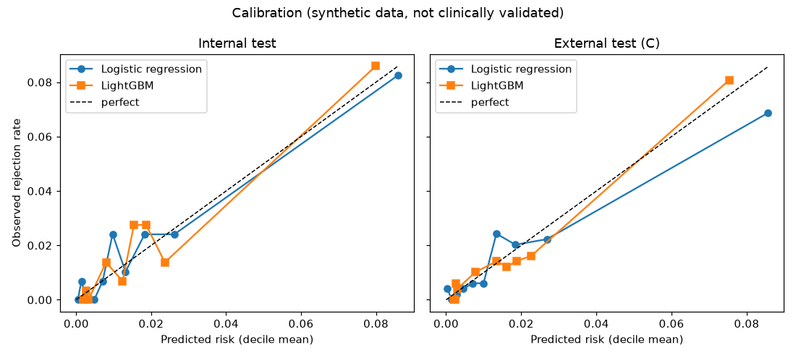
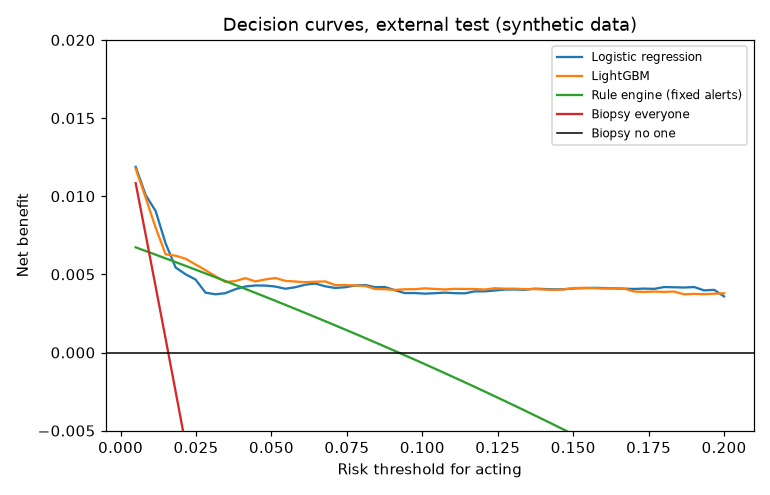

# Rejection-risk model

**Trained on synthetic data, not clinically validated, decision support only.**

Generated 2026-11-12 by `make risk-report` (evals/src/txlens_evals/risk_model.py) on data extracted 2026-09-30. Synthetic data only. Task: at each scheduled surveillance visit, once its results are back, predict a biopsy showing TCMR, ABMR or mixed rejection in the next 90 days. Model card: docs/model_card_risk.md.

## 1. Data and labels

One row per surveillance visit (the first dd-cfDNA draw in each schedule window). A visit is labelled when its 90-day window is fully observed.

| Center | Role | Patients | Visits | Labelled | Rejection visits | Prevalence |
|---|---|---|---|---|---|---|
| center_a | development + internal test | 795 | 8675 | 7800 | 154 | 2.0% |
| center_b | development + internal test | 691 | 7488 | 6724 | 94 | 1.4% |
| center_c | external test | 511 | 5521 | 4943 | 78 | 1.6% |

**OMOP labels against the generator's truth.** Rejection results reach OMOP from approved pathology reports and from clinic-note NLP (a note result counts when a biopsy precedes it by at most 14 days). Reports still waiting in the review queue are missing from OMOP, so the notes carry most of the labels.

- Rejection biopsies (TCMR, ABMR, mixed) up to the extract date: 213 in the truth, 213 found in OMOP (100.0%); 0 OMOP rejection biopsies are not in the truth.
- Borderline biopsies: 61 in the truth, 4 found in OMOP (the note NLP rarely records borderline).
- Visits labelled by both: OMOP finds 326 of 326 truly positive visits (100.0%); 0 OMOP-positive visits are negative in the truth.

## 2. Which draws became visits

The draw reason never reaches OMOP, so the schedule rule cannot see it. It does not drop a draw because a biopsy follows (that is future information). The generator's reason for each kept draw:

| Organ | Visits | Truly scheduled | Truly for-cause | For-cause among rejection visits |
|---|---|---|---|---|
| all | 21684 | 98.6% | 1.4% | 16.3% |
| heart | 3255 | 98.7% | 1.3% | 22.0% |
| kidney | 18429 | 98.6% | 1.4% | 15.2% |

The rule keeps 21375 of 21947 truly scheduled draws (97.4%); a scheduled draw is missed when an earlier draw (often for-cause) falls in the same window. Heart protocol biopsies coincide with scheduled months, so their pre-biopsy draws are scheduled draws.

## 3. Model choice (cross-validation)

Five-fold patient-grouped cross-validation on the development patients (centers A+B, 80%). Rule fixed in advance: LightGBM becomes champion only if its best mean AUPRC beats logistic regression's by at least 0.01.

| Model | Hyperparameters | CV AUPRC | CV AUROC |  |
|---|---|---|---|---|
| Logistic regression | C=0.01 | 0.189 | 0.794 |  |
| Logistic regression | C=0.1 | 0.225 | 0.803 |  |
| Logistic regression | C=1.0 | 0.234 | 0.803 | chosen |
| LightGBM | num_leaves=7, n_estimators=150 | 0.237 | 0.803 | chosen |
| LightGBM | num_leaves=7, n_estimators=300 | 0.232 | 0.805 |  |
| LightGBM | num_leaves=15, n_estimators=150 | 0.231 | 0.802 |  |
| LightGBM | num_leaves=15, n_estimators=300 | 0.224 | 0.796 |  |

Champion: **Logistic regression**.

## 4. Discrimination and calibration

95% intervals resample patients (1,000 resamples). AUPRC should be read against the prevalence (a random score's AUPRC). Calibration: intercept 0 and slope 1 are perfect; a slope below 1 means the scores are too extreme.

| Test | Model | Visits / patients | Rejection visits | AUROC | AUPRC | Prevalence | Brier | Cal. intercept | Cal. slope |
|---|---|---|---|---|---|---|---|---|---|
| Internal (A+B, 20%) | Logistic regression (champion) | 2909 / 295 | 52 | 0.814 (0.745 to 0.868) | 0.240 (0.131 to 0.380) | 0.018 | 0.0157 (0.0107 to 0.0214) | 0.06 | 0.98 |
| Internal (A+B, 20%) | LightGBM | 2909 / 295 | 52 | 0.815 (0.752 to 0.867) | 0.224 (0.117 to 0.348) | 0.018 | 0.0154 (0.0107 to 0.0212) | 0.07 | 1.03 |
| External (C) | Logistic regression (champion) | 4943 / 507 | 78 | 0.804 (0.756 to 0.854) | 0.235 (0.154 to 0.361) | 0.016 | 0.0134 (0.0098 to 0.0174) | -0.09 | 0.93 |
| External (C) | LightGBM | 4943 / 507 | 78 | 0.807 (0.758 to 0.855) | 0.291 (0.204 to 0.392) | 0.016 | 0.0129 (0.0094 to 0.0166) | -0.04 | 1.11 |

## 5. Against the rule engine at the same alert burden

The rule engine alerts when any medium or high flag is active on the visit day (the Step 1.6 definition). The model alerts on the same share of visits: its highest scores. Same alert burden, so the question is which rejections each one catches. The difference is paired by patient.

| Test | Alert rate | Rejection visits caught: rules | Model | Difference (model - rules) | PPV rules | PPV model |
|---|---|---|---|---|---|---|
| Internal | 9.4% | 0.423 (0.315 to 0.524) | 0.462 (0.321 to 0.586) | 0.038 (-0.037 to 0.117) | 8.1% | 8.8% |
| External (C) | 7.7% | 0.449 (0.371 to 0.539) | 0.436 (0.351 to 0.529) | -0.013 (-0.078 to 0.055) | 9.2% | 8.9% |

**Episodes:** a rejection episode counts as caught when at least one visit in the 90 days before its biopsy alerted.

| Test | Episodes | Caught by rules | Caught by model |
|---|---|---|---|
| Internal | 34 | 20 (58.8%) | 19 (55.9%) |
| External (C) | 51 | 33 (64.7%) | 32 (62.7%) |

**A threshold fixed in advance.** Matching the rate on the test set uses the test set; in practice the cut-off is set beforehand. Here it is set on the development out-of-fold scores at the development alert rate, then applied unchanged:

| Test | Model alert rate | Model catches | Rule alert rate | Rules catch |
|---|---|---|---|---|
| Internal | 8.7% | 46.2% | 9.4% | 42.3% |
| External (C) | 9.1% | 43.6% | 7.7% | 44.9% |

## 6. Decision curves

Net benefit = true alerts/n - false alerts/n x t/(1-t), where t is the risk at which a clinician would act (e.g. order a biopsy). Higher is better; "biopsy no one" is 0. External test (center C).

| Threshold | Logistic regression | LightGBM | Rule engine (fixed alerts) | Biopsy everyone |
|---|---|---|---|---|
| 1% | 0.0094 | 0.0090 | 0.0064 | 0.0058 |
| 2% | 0.0051 | 0.0058 | 0.0057 | -0.0043 |
| 3% | 0.0038 | 0.0049 | 0.0049 | -0.0147 |
| 5% | 0.0042 | 0.0047 | 0.0034 | -0.0360 |
| 10% | 0.0038 | 0.0041 | -0.0007 | -0.0936 |
| 20% | 0.0036 | 0.0038 | -0.0104 | -0.2303 |

## 7. What the models use

Mean absolute contribution to the log-odds on the external test (logistic regression: coefficient x standardised value; LightGBM: TreeSHAP). The generator gives tacrolimus variability, donor type and delayed graft function no effect on rejection, so values near zero there are the expected result, not a failure.

| Feature | Logistic regression | LightGBM |
|---|---|---|
| Time since transplant | 0.869 | 0.867 |
| dd-cfDNA (log) | 0.849 | 0.104 |
| Heart graft | 0.684 | 0.070 |
| Prior rejection | 0.521 | 0.043 |
| Deceased donor | 0.121 | 0.028 |
| Creatinine change | 0.107 | 0.110 |
| Tacrolimus variability | 0.104 | 0.082 |
| DSA positive | 0.079 | 0.021 |
| dd-cfDNA vs own lowest | 0.078 | 0.059 |
| dd-cfDNA trend | 0.060 | 0.159 |
| Delayed graft function | 0.018 | 0.002 |

## 8. Sensitivity analyses

Each line reruns the whole development (selection, refits, tests) unless noted. Cells: AUROC, AUPRC, rejection visits, and rejection visits caught by the model vs the rule engine at the same alert burden.

| Analysis | Champion | Int. AUROC | Int. AUPRC | Int. events | Int. caught | Ext. AUROC | Ext. AUPRC | Ext. events | Ext. caught |
|---|---|---|---|---|---|---|---|---|---|
| Main analysis | Logistic regression | 0.814 | 0.240 | 52 | 46.2% vs 42.3% | 0.804 | 0.235 | 78 | 43.6% vs 44.9% |
| Borderline counted as rejection | Logistic regression | 0.759 | 0.184 | 52 | 32.7% vs 32.7% | 0.804 | 0.234 | 78 | 43.6% vs 44.9% |
| Test labels from the truth (same models) | Logistic regression | 0.814 | 0.240 | 52 | 46.2% vs 42.3% | 0.804 | 0.235 | 78 | 43.6% vs 44.9% |
| (a) Without draws <= 14 days before a biopsy | Logistic regression | 0.776 | 0.111 | 37 | 29.7% vs 18.9% | 0.744 | 0.091 | 54 | 24.1% vs 25.9% |
| (b) Visits = truly scheduled draws | Logistic regression | 0.759 | 0.249 | 44 | 38.6% vs 34.1% | 0.778 | 0.212 | 67 | 34.3% vs 35.8% |

(a) uses the future (it knows a biopsy is coming) and could never run live; it shows how much of the result rests on draws taken because a clinician was already worried. (b) uses the generator's draw reason, which OMOP does not have.

**By organ** (champion, internal + external test visits):

| Organ | Visits | Rejection visits | AUROC | AUPRC |
|---|---|---|---|---|
| heart | 1092 | 23 | 0.803 | 0.350 |
| kidney | 6760 | 107 | 0.808 | 0.213 |

## 9. Fairness: age band and sex

Champion on all test visits (internal + external), alerting at the rule engine's rate. Groups with fewer than 11 rejection visits are not scored. The generator gives age and sex no effect on rejection, so differences here are noise or follow from other features.

| By | Group | Visits | Rejection visits | AUROC | Brier | Alert rate | Rejections caught |
|---|---|---|---|---|---|---|---|
| Age band | 18-39 | 2911 | 53 | 0.800 | 0.0156 | 7.4% | 43.4% |
| Age band | 40-59 | 3032 | 52 | 0.814 | 0.0143 | 8.5% | 44.2% |
| Age band | 60+ | 1909 | 25 | 0.810 | 0.0122 | 9.5% | 40.0% |
| Sex | female | 3051 | 53 | 0.789 | 0.0141 | 8.1% | 39.6% |
| Sex | male | 4801 | 77 | 0.820 | 0.0144 | 8.4% | 45.5% |

## 10. Drift

Population stability index (PSI): < 0.1 stable, 0.1-0.25 watch, > 0.25 shifted. Missing values form their own bin. Over time compares visits of patients transplanted in 2022-2023 with 2024-2025 (the later group has shorter follow-up, so time since transplant shifts by design).

| Feature | A+B vs C |  | Early vs late transplants |  |
|---|---|---|---|---|
| dd-cfDNA (log) | 0.006 | stable | 0.003 | stable |
| dd-cfDNA trend | 0.005 | stable | 0.045 | stable |
| dd-cfDNA vs own lowest | 0.015 | stable | 0.038 | stable |
| Creatinine change | 0.003 | stable | 0.024 | stable |
| Tacrolimus variability | 0.002 | stable | 0.009 | stable |
| DSA positive | 0.025 | stable | 0.000 | stable |
| Time since transplant | 0.000 | stable | 0.964 | shifted |
| Prior rejection | 0.000 | stable | 0.001 | stable |
| Heart graft | 0.000 | stable | 0.002 | stable |
| Deceased donor | 0.002 | stable | 0.002 | stable |
| Delayed graft function | 0.002 | stable | 0.000 | stable |
| **Risk score** | 0.002 | stable | 0.242 | watch |

Nightly scoring has not been set up in this database yet.

## 11. Registered model

`txlens-rejection-risk@champion` is version 1 (run `a46ba6d2a7b8471fbfed1462d0c8ec15`). Its logged external AUROC is 0.8037; this report's is 0.8037: the same development, as expected.
